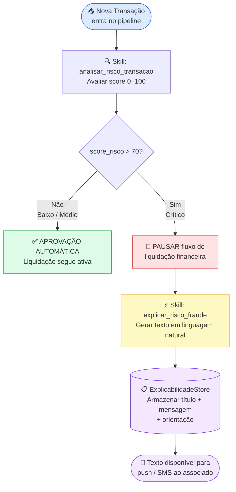

# 🤖 Orchestration — Pipeline de Agente Anti-Fraude

Ambiente de orquestração que importa o servidor MCP local `mcp_antifraude` e
expõe suas ferramentas como **Skills** conectadas — compatível com IBM watsonx
Orchestrate e ambientes similares.

---

## Estrutura do pacote

```
orchestration/
├── __init__.py        # Exports públicos do pacote
├── skills.py          # Skills conectadas ao servidor MCP (SkillRegistry)
├── agent_flow.py      # AgenteAntiFraude — lógica de orquestração e pausa de liquidação
└── pipeline.py        # Entry point: processa lote de transações e emite relatório
```

---

## Fluxo configurado



### Limiar de risco

| Score    | Nível   | Decisão                      | Liquidação    |
|----------|---------|------------------------------|---------------|
| 0–35     | BAIXO   | Aprovação automática         | ATIVA         |
| 36–70    | MÉDIO/ALTO | Aprovação automática      | ATIVA         |
| > 70     | CRÍTICO | Pendente revisão             | **PAUSADA**   |

---

## Skills registradas

### `analisar_risco_transacao`

Conectada à ferramenta MCP homônima de `mcp_antifraude/server.py`.

**Parâmetros de entrada:**

```json
{
  "transacao_json": "<string JSON com os campos da transação>"
}
```

**Retorno:**

```json
{
  "transacao_id": "tx_001",
  "associado_id": "assoc_001",
  "score_risco": 80,
  "nivel_risco": "CRITICO",
  "regras_violadas": [
    { "regra": "PICO_TRANSACAO", "descricao": "...", "detalhe": "..." }
  ],
  "historico_usado": 5
}
```

---

### `explicar_risco_fraude`

Invocada **apenas quando `score_risco > 70`**. Conectada à ferramenta MCP
homônima de `mcp_antifraude/server.py`.

**Parâmetros de entrada:**

```json
{
  "resultado_analise_json": "<string JSON retornado por analisar_risco_transacao>"
}
```

**Retorno:**

```json
{
  "transacao_id": "tx_001",
  "associado_id": "assoc_001",
  "score_risco": 80,
  "requer_validacao": true,
  "titulo": "⚠️ Sua compra precisa de confirmação ...",
  "mensagem_associado": "Olá! Identificamos algo diferente ...",
  "orientacao": "Responda SIM para confirmar ..."
}
```

---

## Como executar

### Pré-requisitos

```bash
pip install mcp
```

### Rodar o pipeline demo (4 transações de teste)

```bash
# a partir da raiz do projeto
python -m orchestration.pipeline
```

### Usar programaticamente

```python
from orchestration.pipeline import executar_pipeline

transacoes = [
    {
        "transacao_id": "tx_001",
        "associado_id": "assoc_001",
        "valor": 5000.00,          # pico extremo
        "categoria": "Eletrônicos", # alto risco
        "timestamp": "2026-11-03T02:00:00",  # madrugada
        "latitude": -23.5505,
        "longitude": -46.6333,
    }
]

resultados = executar_pipeline(transacoes)

for r in resultados:
    print(r.decisao, r.status_liquidacao)
    if r.explicacao:
        print(r.explicacao["mensagem_associado"])
```

### Usar o SkillRegistry diretamente

```python
from orchestration.skills import registry
import json

analise = registry.invocar(
    "analisar_risco_transacao",
    transacao_json=json.dumps({
        "transacao_id": "tx_test",
        "associado_id": "assoc_001",
        "valor": 5000.0,
        "categoria": "Joalherias",
        "timestamp": "2026-11-03T03:00:00",
    })
)

print(analise["score_risco"])   # → 60 ou mais
```

---

## Transporte MCP (stdio)

O `SkillRegistry` se comunica com o servidor MCP via **subprocess stdio**,
conforme o protocolo JSON-RPC 2.0 do MCP:

```
Agent → stdin  → MCP Server (server.py)
Agent ← stdout ← MCP Server
```

Em produção com IBM watsonx Orchestrate, substitua `_chamar_ferramenta_mcp()`
por chamadas à API do servidor MCP registrado no `.bob/mcp.json` (entrada
`anti-fraude`).

---

## ExplicabilidadeStore

As explicações geradas para transações com `score > 70` são armazenadas em
`ExplicabilidadeStore` (em memória por padrão). Para persistência em produção,
substituir por:

- **Redis** — acesso < 5 ms para consulta em tempo real pelo analista
- **PostgreSQL** — registro auditável de longo prazo
- **S3 / Object Storage** — arquivo de logs para retraining do modelo

---

*Arquitetura projetada conforme os arquétipos **Guardião de Tomada de Decisão** e
**Redutor de Carga Cognitiva** — AI Experiential Learning Lab 2026*
