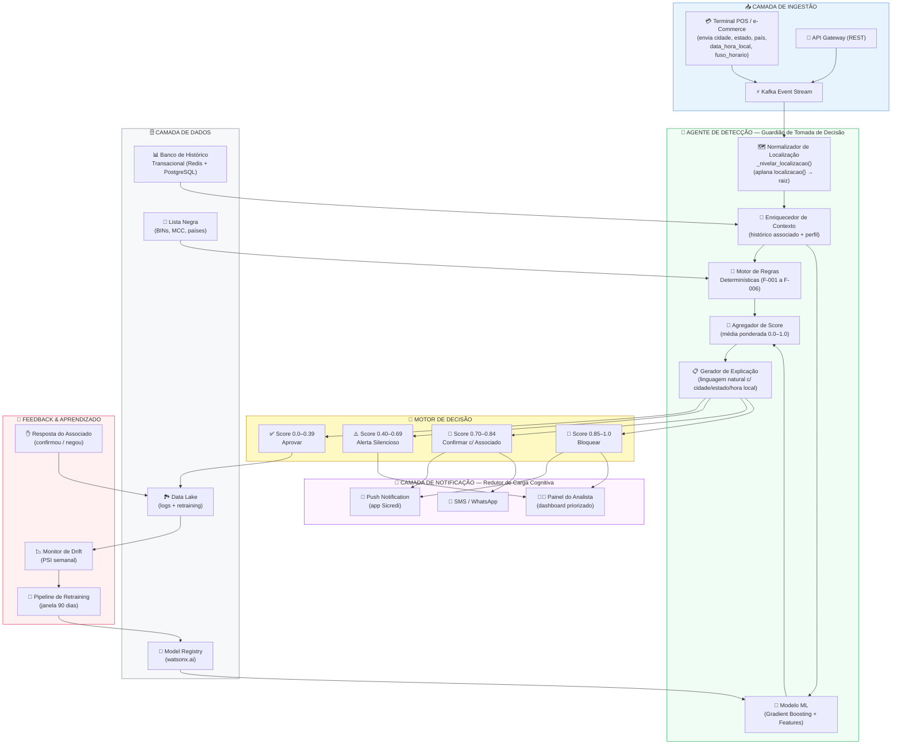
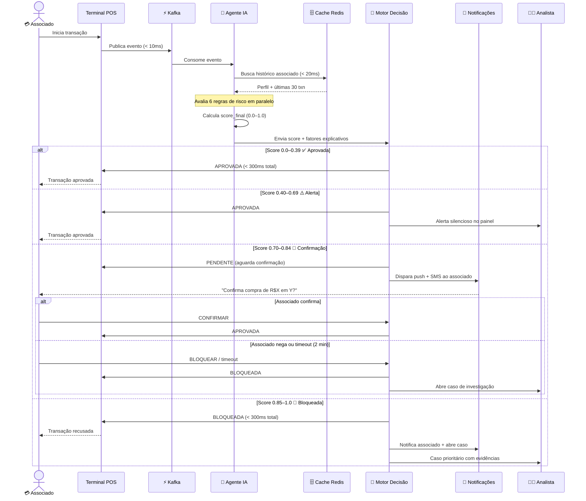
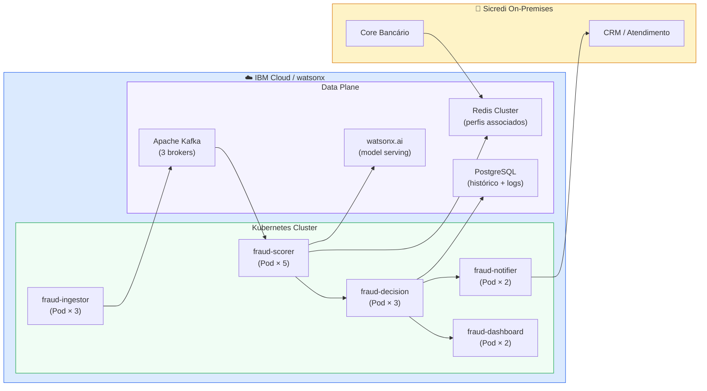
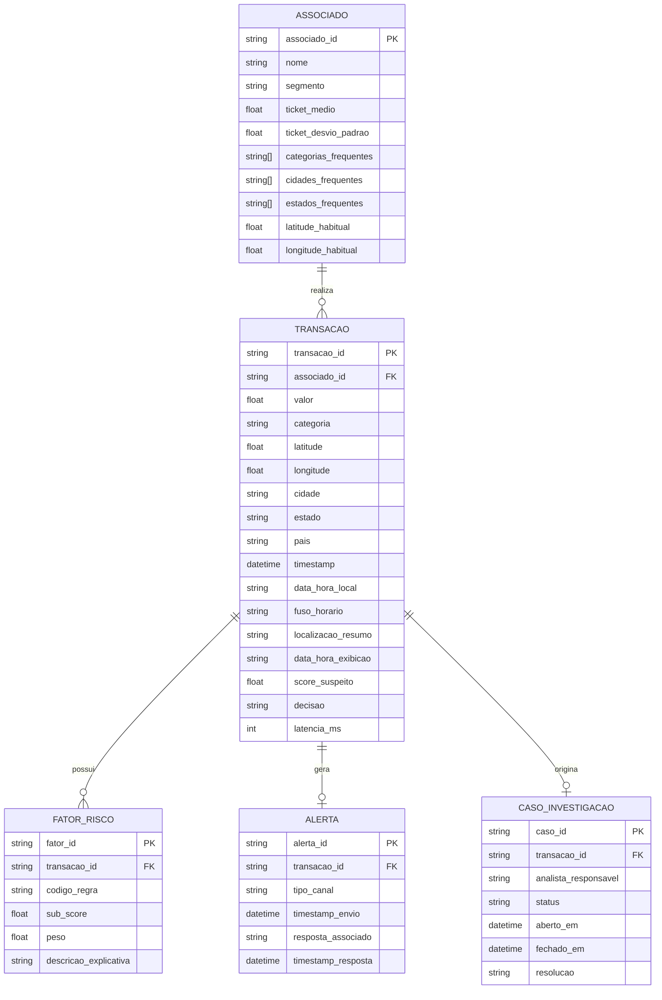
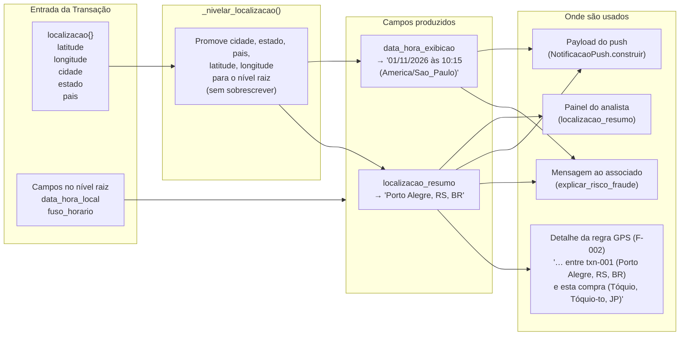

# 🏗️ Arquitetura — Sistema de Prevenção de Fraudes em Tempo Real
### Sicredi | Trilha 4 | AI Experiential Learning Lab 2026

---

## Diagrama de Arquitetura Geral

---

## Diagrama de Fluxo de Decisão (por Transação)

---

## Diagrama de Componentes e Implantação

---

## Modelo de Dados — Relacionamento de Entidades

---

## Fluxo de Dados de Localização

---

## Decisões de Arquitetura (ADRs)

### ADR-001: Stream-first com Kafka
**Decisão:** Usar Apache Kafka como backbone de eventos em vez de REST síncrono para ingestão.
**Motivo:** Desacopla o processador de cartões do agente de IA, evitando que latência do ML impacte o terminal. O resultado da decisão é enviado de volta assincronamente ao autorizador.

### ADR-002: Modelo ML + Regras Determinísticas em paralelo
**Decisão:** Executar regras determinísticas (velocidade, GPS) e modelo ML em paralelo, agregando scores com pesos.
**Motivo:** Regras oferecem explainability e baixa latência; ML captura padrões complexos não cobertos por regras. O fallback em caso de falha do ML é as regras determinísticas isoladas.

### ADR-003: Cache Redis para perfil do associado
**Decisão:** Manter os últimas 30 transações e o perfil comportamental do associado em Redis.
**Motivo:** Latência de leitura < 5 ms contra > 50 ms no banco relacional. TTL de 24 horas com invalidação via evento de nova transação.

### ADR-004: Timeout de 2 minutos para confirmação do associado
**Decisão:** Se o associado não responder ao push/SMS em 2 minutos, enviar um alerta orientando o associado a entrar em contato com sua agência Sicredi — sem bloqueio automático.
**Motivo:** Evitar bloqueios indevidos por falha de conectividade ou atraso na entrega da notificação, preservando a experiência do associado. A agência realiza a validação presencial e aciona os procedimentos cabíveis.

### ADR-005: Campos de localização e data/hora como opcionais
**Decisão:** `cidade`, `estado`, `pais`, `data_hora_local` e `fuso_horario` são opcionais. Quando ausentes, o motor opera normalmente com coordenadas brutas ou sem contexto geográfico textual.
**Motivo:** Retrocompatibilidade com terminais POS e integrações existentes que não fornecem esses campos. A análise de risco (lat/lon para Haversine) não depende dos campos textuais — eles servem exclusivamente para enriquecer as mensagens ao associado e ao analista.

### ADR-006: Nivelamento automático do sub-objeto `localizacao`
**Decisão:** A função `_nivelar_localizacao()` em [`mcp_antifraude/server.py`](./mcp_antifraude/server.py) e a lógica equivalente em [`notificacao_push.py`](./.bob/orchestration/notificacao_push.py) promovem campos aninhados ao nível raiz sem copiar o objeto inteiro.
**Motivo:** O dataset de testes usa `"localizacao": {…}` aninhado (padrão do projeto), mas a API pública do motor aceita campos no nível raiz. Uma única função de normalização no início do fluxo elimina a necessidade de adaptar cada regra individualmente.

---

*Arquitetura projetada conforme os arquétipos: **Guardião de Tomada de Decisão** e **Redutor de Carga Cognitiva** — AI Experiential Learning Lab 2026*
