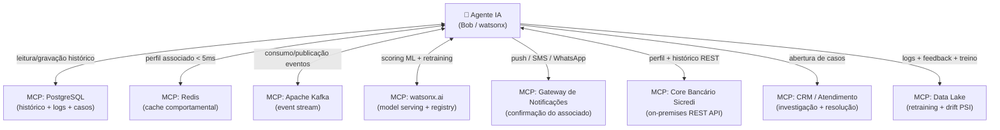

# com base na estrutura inicial do projeto, liste os projetos de mcp que poderão ser necessários

---

**Status:** active  **Date:** 2026-11-02

---

### 👤 User

com base na estrutura inicial do projeto, liste os projetos de mcp que poderão ser necessários

---

### 🤖 Assistant

> 🔧 called: list_files

> 🔧 **list_files** — c:\Users\Usuario\.bob\playground\projeto-anti-fraude

### 🤖 Assistant

> 🔧 called: read_file, read_file

> 🔧 **read_file** — c:\Users\Usuario\.bob\playground\projeto-anti-fraude\architecture.md

> 🔧 **read_file** — c:\Users\Usuario\.bob\playground\projeto-anti-fraude\README.md

### 🤖 Assistant

Com base na análise completa do projeto, aqui está um mapeamento detalhado dos **servidores MCP** que seriam necessários, organizados por camada da arquitetura:

---

## 🔌 Servidores MCP Necessários — Projeto Anti-Fraude Sicredi

### 1. 🗄️ **MCP para Dados Transacionais (PostgreSQL)**
**Justificativa:** O projeto usa PostgreSQL para histórico transacional, logs de decisão e casos de investigação (entidades `TRANSACAO`, `FATOR_RISCO`, `CASO_INVESTIGACAO`).

> Permite que o agente consulte e grave histórico de transações, fatores de risco e decisões auditáveis diretamente no banco relacional.

---

### 2. ⚡ **MCP para Cache Redis**
**Justificativa:** O [`ADR-003`](architecture.md) define Redis como o cache do perfil comportamental do associado (últimas 30 transações), com TTL de 24h.

> Permite que o agente leia e atualize perfis de associados com latência < 5ms para alimentar o enriquecimento de contexto.

---

### 3. 📨 **MCP para Apache Kafka (Event Streaming)**
**Justificativa:** Kafka é o backbone de eventos ([`ADR-001`](architecture.md)). Eventos de transação chegam via stream ao agente.

> Permite que o agente consuma eventos de transações em tempo real e publique decisões de volta ao autorizador de forma assíncrona.

---

### 4. 🤖 **MCP para watsonx.ai (Model Serving)**
**Justificativa:** O modelo de Gradient Boosting é servido via `watsonx.ai` (Model Registry + Model Serving).

> Permite que o agente invoque o modelo ML para scoring e que o pipeline de retraining atualize modelos no registry.

---

### 5. 📲 **MCP para Gateway de Notificações (Push / SMS / WhatsApp)**
**Justificativa:** Módulo F4 exige envio de notificações push, SMS e WhatsApp para confirmação pelo associado (score 0.70–0.84) e alerta de bloqueio (score ≥ 0.85).

> Permite que o agente dispare notificações multi-canal com linguagem natural e processe a resposta do associado.

---

### 6. 🏦 **MCP para Core Bancário Sicredi (REST API)**
**Justificativa:** Integração com o core bancário on-premises para enriquecimento com histórico do associado (módulo F1).

> Permite que o agente acesse dados de perfil do cliente diretamente do core bancário via REST.

---

### 7. 🎫 **MCP para CRM / Canal de Atendimento**
**Justificativa:** Casos de investigação precisam ser abertos automaticamente no CRM quando score ≥ 0.85 ou quando o associado nega a transação.

> Permite que o agente crie, atualize e consulte casos no CRM com os fatores de risco e evidências da transação.

---

### 8. 🏞️ **MCP para Data Lake (Logs + Retraining)**
**Justificativa:** Módulo F6 requer que logs de decisão e feedback dos associados sejam enviados ao Data Lake para retraining semanal e monitoramento de drift (PSI).

> Permite que o agente grave eventos de feedback e leia dados históricos para o pipeline de aprendizado contínuo.

---

## Resumo Visual

---

### 📋 Tabela de Prioridade

| MCP | Criticidade | Fase |
|---|---|---|
| **PostgreSQL** | 🔴 Essencial | MVP |
| **Redis** | 🔴 Essencial | MVP |
| **watsonx.ai** | 🔴 Essencial | MVP |
| **Kafka** | 🔴 Essencial | MVP |
| **Gateway de Notificações** | 🟠 Alta | MVP |
| **Core Bancário** | 🟠 Alta | MVP |
| **CRM / Atendimento** | 🟡 Média | Fase 2 |
| **Data Lake** | 🟡 Média | Fase 2 |

Os quatro primeiros (PostgreSQL, Redis, watsonx.ai e Kafka) formam o núcleo mínimo para o fluxo de detecção e decisão funcionar em tempo real.

---

### 👤 User

quanto tempo ainda tenho para usar esse plano

---

### 🤖 Assistant

> 🔧 called: search_ibm_docs

> 🔧 **search_ibm_docs** — bob

### 🤖 Assistant

Não tenho acesso às informações da sua conta, como data de início, expiração do plano ou saldo de Bobcoins. Esses dados são pessoais e não ficam disponíveis para mim.

Para verificar quanto tempo ainda tem no seu plano, você pode:

1. **Acessar as configurações da sua conta** diretamente no painel do Bob — lá você encontra detalhes do plano atual, ciclo de cobrança e alocação de Bobcoins.
2. **Entrar em contato com o suporte IBM** caso tenha dúvidas sobre expiração de trial ou plano Enterprise.

Se tiver um plano **Enterprise com pacotes de Bobcoins**, a documentação indica que eles **expiram 1 ano após a data de compra**.